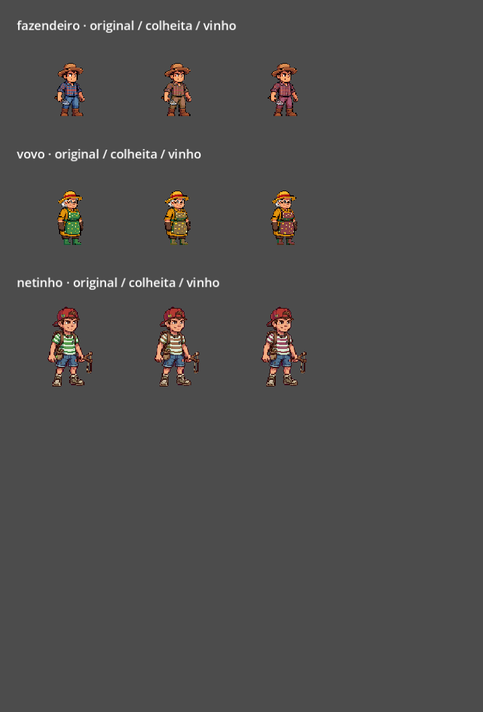
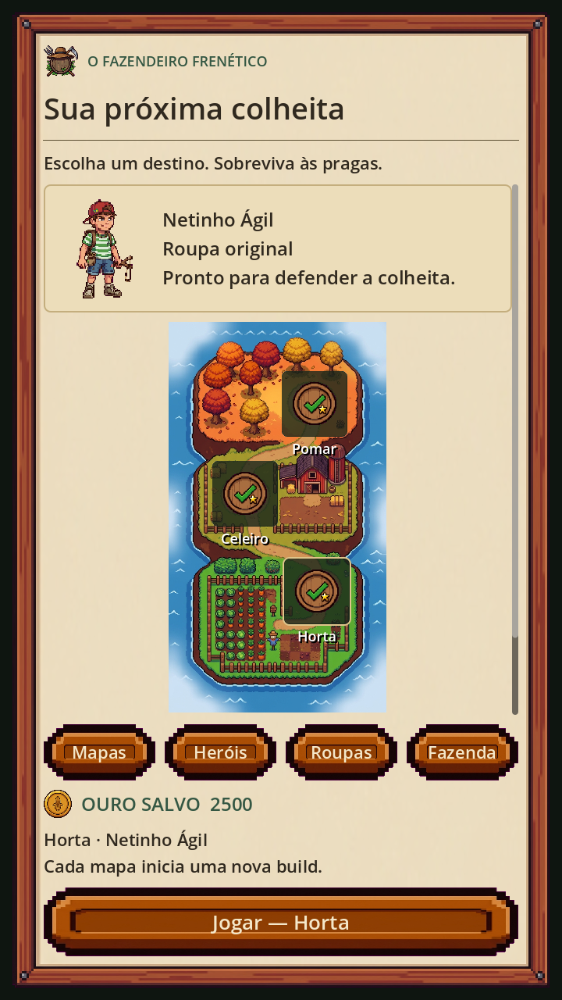
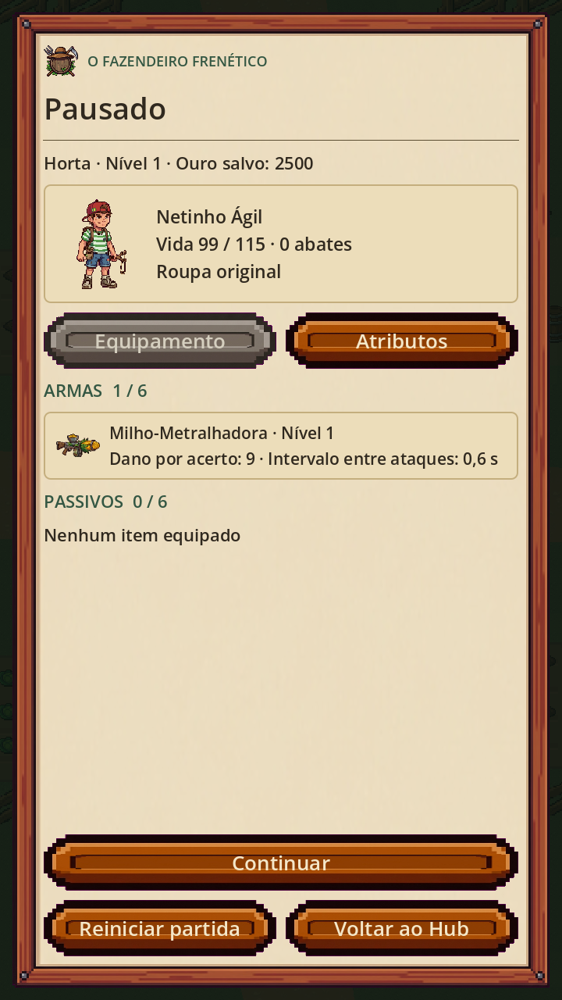
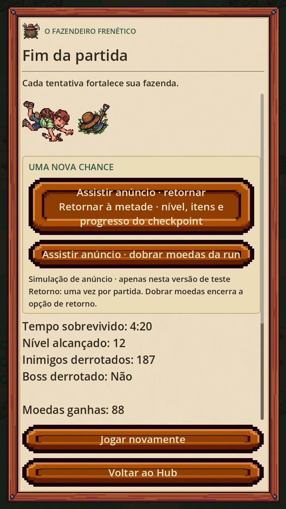

# Polimento visual, roupas e anúncios recompensados

Implementado e validado em Windows com Godot 4.7.2 em 18/10/2026. Este relatório descreve o código atual. Os documentos visuais anteriores continuam como histórico.

## Entrega visual

Foram integrados **126 quadros PNG com alpha real**, em **28 ciclos de oito famílias**. As fontes Aseprite, filmstrips, GIFs e resultados do validador estão nas pastas de cada personagem abaixo. Os PNGs ativos ficam em `art/atores_polidos`; `actor_polish_data.gd` é o catálogo consumido por `GameArt`.

| Família | Quadros | Estados integrados | Correção principal |
|---|---:|---|---|
| Netinho Ágil | 24 | idle, walk, run, death | Tronco original estável, pernas alternadas, corrida própria e morte da mesma família visual |
| Pulgão | 12 | idle, walk, death | Direção constante; morte completa |
| Mosca | 18 | idle, walk, attack, death | Corpo estável e asas independentes; ataque/morte com silhueta inteira |
| Gafanhoto | 18 | idle, anticipate, jump, land, death | Preparação e pouso coerentes, sem redimensionar cada pose agachada |
| Lesma | 10 | idle, walk | Respiração e ondulação discretas, mantendo o volume |
| Lagarta Titã | 12 | idle, walk | Remove a alternância entre corpo grande e pequeno |
| Rainha das Moscas | 18 | idle, walk, attack, death | Elimina metades cortadas e fragmentos de células vizinhas |
| Gafanhoto Gigante | 14 | idle, anticipate, jump, land | Usa a referência completa, sem moldura ou extremidades cortadas |

O Fazendeiro e a Vovó continuam usando os pacotes anteriormente aprovados, com seus gestos próprios. Os companheiros mantêm as famílias existentes por nível. Lesma, Lagarta e Gigante continuam com o efeito genérico de morte já existente; não foi inventada uma sequência anatômica nova para essas três famílias.

### Identidade e método

- O Netinho mantém boné vermelho, camisa listrada, mochila e estilingue. A antiga referência de roupa laranja não foi misturada à família nova.
- Os inimigos mantêm cores, rostos, ferramentas e silhuetas das fontes fornecidas pelo usuário.
- Recorte, transparência, articulação, exportação e GIFs foram produzidos no Aseprite. Os scripts Python organizam metadados, analisam ou copiam arquivos; não redesenham os PNGs.
- Fontes e caminhos efetivamente usados: [sources.json](sources.json). Catálogo e tempos: [catalog.json](catalog.json).
- A duração de cada quadro é explícita. O runtime mantém nearest filtering e texturas em cache; nenhuma animação troca o collider por uma caixa derivada da imagem.
- O arco do salto desloca somente `Sprite2D.position`. Velocidade, dano, duração física e momento de impacto continuam os anteriores. Pausa congela arco, quadros e Timer de pouso; o pool zera o deslocamento.
- As fontes originais permanecem disponíveis. Os recortes antigos substituídos deixaram de ser escolhidos pelo catálogo ativo.

### Revisão visual e limites

A revisão independente teve três rodadas de correções localizadas. Notas finais: Netinho 7,0; Pulgão 7,2; Mosca 7,1; Gafanhoto 7,0; Lesma 7,2; Lagarta 7,5; Rainha 7,3; Gigante 7,2. Nenhum bloqueador visual permaneceu.

O acabamento ainda admite evolução: braços do Netinho participam pouco da passada; voo e ondulações são discretos; a morte das moscas usa tombamento simples. Não é uma promessa de animação desenhada quadro a quadro no padrão de uma grande produção.

O validador Aseprite aprovou mecanicamente **26 dos 28 ciclos**. Nas mortes de Mosca e Gafanhoto ele ainda marca pequenos pixels diagonais de patas/antenas como isolados em algumas camadas. A revisão visual os considerou não bloqueadores. Os relatórios originais `validation.json` foram preservados, incluindo esses apontamentos e as notas sobre paletas extensas herdadas das referências JPG. Isso é separado dos testes de runtime abaixo.

## Lobby, pausa e vestiário

- Lobby com personagem animado, roupa equipada e mapa de campanha com legendas curtas sem sobreposição.
- Aba **Heróis** com prévias animadas; aba **Roupas** com prévia antes da compra.
- Pausa com personagem, vida, abates, roupa, inventário em cartões e atributos existentes.
- Prévia dimensionada pela área visível dos sprites, mantendo margens para chapéus, botas e acessórios.
- Transição curta de entrada no lobby e pausa. Conteúdo longo permanece rolável, com ações principais fixas.

### Cosméticos atuais

| Roupa | Preço em ouro do jogo | Disponibilidade |
|---|---:|---|
| Original | 0 | Padrão de cada personagem |
| Colheita | 250 | Compra separada por personagem |
| Vinho da Serra | 400 | Compra separada por personagem |

São **variações de paleta do traje**, sem novos modelos de roupa ou bônus de atributos. O shader preserva o alpha e o sombreamento dos quadros originais. Personagem bloqueado não pode comprar roupa. Compra e débito são salvos juntos; falha de gravação reverte ambos. Compra duplicada não cobra novamente. Seleção fica salva por personagem.



## Retorno após anúncio: regra implementada

1. Cada run possui um identificador próprio e pode consumir **um retorno**.
2. O checkpoint é capturado uma vez, ao cruzar 50% do tempo planejado das fases da campanha, incluindo intervalos. Nos mapas atuais, corresponde a **169 segundos**. O tempo de combate do chefe, variável, não faz parte desse cálculo.
3. Morte depois desse ponto restaura o estado do checkpoint: personagem, posição, vida registrada, nível, XP, armas e níveis, passivos, atributos, tempo, fase, inimigos/vida e orbes ainda presentes.
4. Morte antes desse ponto usa o estado do momento da morte e restaura vida cheia. A progressão daquela tentativa é mantida.
5. Timers das armas, inimigos, spawner e tempo restante da coleta automática são restaurados. O intervalo repetido permanece o original.
6. Projéteis, armadilhas, companheiros invocados e efeitos transitórios da linha do tempo descartada são limpos; as armas recriam suas entidades normalmente. Uma animação de ataque em andamento não é um snapshot visual exato.
7. Ao retornar, o jogador recebe dois segundos de proteção contra dano imediato. Isso é uma regra do retorno, sem alterar os atributos-base.
8. O checkpoint vive na memória da run. Fechar o aplicativo descarta a partida; não foi adicionado salvamento de campanha em andamento.

O anúncio é opcional. Fechar sem receber o evento de recompensa, falha ao carregar, timeout ou sair da cena não concede retorno.

### Moedas sem pagamento repetido

O ouro permanente é independente do snapshot. Moedas e bônus de chefe já salvos não são desfeitos pelo retorno. A liquidação seguinte paga somente o que superar o maior valor-base já liquidado na mesma run. Exemplo: pagamento inicial de 80; depois de voltar, encerrar com 60 paga zero; encerrar com 110 paga mais 30.

**Dobrar moedas** acrescenta uma vez o total-base da run mais o bônus de chefe já computado. O recibo impede repetição e encerra a opção de retorno dessa run. O bônus de vitória continua sendo salvo no momento da vitória, inclusive se o jogador seguir no modo livre.

Uma recompensa confirmada cujo save falhou fica pendente na tela: o jogador pode tentar salvar sem assistir outro anúncio. As saídas ficam bloqueadas até resolver essa gravação, evitando descartar silenciosamente a autorização. Essa pendência é local à sessão, não uma confirmação recuperável após encerrar o aplicativo.

## Arquitetura

| Arquivo | Responsabilidade |
|---|---|
| `rewarded_ads.gd` | Máquina de estados, tokens, dono da solicitação, timeout, bloqueio de pausa e áudio |
| `rewarded_admob_provider.gd` | Adaptador nativo AdMob/UMP, carregamento, exibição e confirmação de recompensa |
| `rewarded_demo_provider.gd` | Simulação explícita para desenvolvimento, com conclusão ou fechamento manual |
| `run_checkpoint.gd` | Captura e restauração da run; sem controle sobre a carteira permanente |
| `save_manager.gd` | Recibos por run, liquidação incremental, roupas, compras e rollback |
| `run_end_ui.gd` | Ofertas opcionais, mensagens de indisponibilidade e recuperação de save |
| `skin_catalog.gd` / `clothing_palette.gdshader` | Catálogo e apresentação cosmética |
| `sprite_animator.gd` / `actor_polish_data.gd` | Tempos e seleção da família visual |

Fluxo de anúncio: `UNAVAILABLE → READY → LOADING → SHOWING → FINISHING → READY`. Apenas o evento de recompensa autoriza a ação. Fechamento é processado após esvaziar callbacks diferidos imediatos. Callbacks de tokens antigos são ignorados. A pausa de anúncio tem dono próprio: encerrá-la não remove pausa de resultado ou de perda de foco.

Os recibos ficam no JSON local do jogo, com escrita temporária seguida de rename. Não foi criado backend, conta online ou validação de recompensa por servidor; o sistema não pretende impedir adulteração manual do save.

## AdMob: instalado, ainda em teste

O plugin oficial [Poing Studios v5.1.0](https://github.com/poingstudios/godot-admob-plugin/releases/tag/v5.1.0) e os binários Android correspondentes foram adicionados em `addons/admob`. O adaptador foi escrito contra os arquivos reais dessa versão. Ela usa o SDK Google Mobile Ads Next-Gen pelas dependências Gradle do plugin.

- Android habilitado no plugin; iOS desabilitado.
- `game_ads/test_mode = true`.
- Unidade rewarded de teste: `ca-app-pub-3940256099942544/5224354917`.
- App ID padrão de teste do plugin: `ca-app-pub-3940256099942544~3347511713`.
- Desktop comum não simula anúncio automaticamente: as ofertas aparecem indisponíveis.
- `--demo-rewarded-ads`, apenas em build de debug, habilita uma tela claramente identificada como simulação. Ela não mostra anúncios reais.
- No Android, o provedor consulta UMP e inicializa o SDK somente com consentimento obtido ou não necessário. As preferências de privacidade podem ser reabertas no vestiário.

### Para validar no Android

1. Instalar os templates de exportação Godot 4.7.2 e configurar Java/Android SDK no editor.
2. Instalar o template de build Android no projeto e criar um preset Android com Gradle habilitado. **Este pacote ainda não inclui um preset Android nem APK/AAB.**
3. Exportar uma build de debug com os IDs de teste acima e testar em aparelho: carregamento, falta de rede, fechar anúncio, recompensa, voltar do segundo plano e anúncios consecutivos entre runs.
4. Conferir a apresentação de consentimento com a configuração UMP da conta e o botão de preferências.

### Para produção

1. Configurar o aplicativo e a unidade rewarded na conta AdMob.
2. Definir `admob/general/android/app_id` com o App ID do jogo e `game_ads/rewarded_unit_id` com a unidade rewarded própria.
3. Depois de validar, definir `game_ads/test_mode = false` na build de release. Builds de debug continuam usando a unidade de teste.
4. Configurar as mensagens UMP, a política de privacidade do jogo e os dados da publicação conforme o público e as funcionalidades efetivamente usadas.
5. Fazer o teste final de integração no aparelho antes da publicação. Compilação GDScript e testes com provedor controlado não comprovam a entrega de um anúncio real.

Referências consultadas: [rewarded e confirmação de recompensa](https://developers.google.com/admob/android/rewarded), [UMP](https://developers.google.com/admob/android/privacy). As APIs GDScript e as dependências exatas são as do plugin instalado.

## Validação executada

**508 verificações passaram**, em nove suítes, sem falha na execução final:

| Suíte | Checks | Abrangência |
|---|---:|---|
| `stability_suite.gd` | 78 | Joystick, colisão, pool, pausa, timers, vitória e runs consecutivas |
| `ui_suite.gd` | 121 | Cartas e números reais, compras, confirmação, scroll e telas em diferentes proporções |
| `art_suite.gd` | 76 | Famílias corretas, alpha/margens, morte, efeitos e reset no pool |
| `farmer_animation_suite.gd` | 45 | Fazendeiro, gestos, corrida, cancelamento e fallback por FPS |
| `vovo_animation_suite.gd` | 37 | Vovó, plantio, morte e preservação das outras famílias |
| `map_landscape_suite.gd` | 77 | Cenário, cache limitado, deslocamento e invariantes de gameplay |
| `monetization_suite.gd` | 50 | Checkpoint, roupas, recibos, callbacks, falhas de save, áudio, foco, timeout e dobra |
| `actor_polish_suite.gd` | 18 | Metadados dos 126 quadros, arco visual, pausa e reset dos saltadores |
| `cosmetic_render_suite.gd` | 6 | Comparação de pixels renderizados das seis variantes: mudança de cor e alpha preservado |

Foram renderizadas e inspecionadas dez capturas em OpenGL Compatibility: lobby, heróis, três vestiários, mobs no mapa, pausa, resultado, anúncio simulado e comparação de roupas. A passagem visual do anúncio é uma simulação; não houve validação em Android físico.

Logs finais: [testes/](testes/). As suítes usam saves em `tests/.tmp`, sem escrever no progresso pessoal. Não foram modificados `enemy_db.gd`, `weapon_db.gd`, `passive_db.gd`, `character_db.gd` ou `map_db.gd` nesta entrega.

Execução de uma suíte, na raiz do jogo:

```powershell
& 'CAMINHO/Godot_v4.7.2-stable_win64_console.exe' --headless --path . --script res://tests/monetization_suite.gd
```

Para conferir as telas e o anúncio simulado:

```powershell
& 'CAMINHO/Godot_v4.7.2-stable_win64_console.exe' --path . --rendering-method gl_compatibility --script res://tests/polish_visual_smoke.gd -- --demo-rewarded-ads
```

## Capturas





## Manutenção da arte

As fontes editáveis estão nas pastas de cada família. O gerador nativo está em `tools/aseprite/polish_actors.lua`; `tools/plan_actor_polish.py` cria o plano de extração usando as referências locais, e `tools/install_actor_polish.py` copia os exports sem alterar pixels e gera o catálogo GDScript. Reexecutar a geração do zero exige essas referências e Aseprite. Para ajustes locais, é possível editar diretamente as fontes `.aseprite` arquivadas, exportar os quadros e atualizar os tempos do catálogo.
