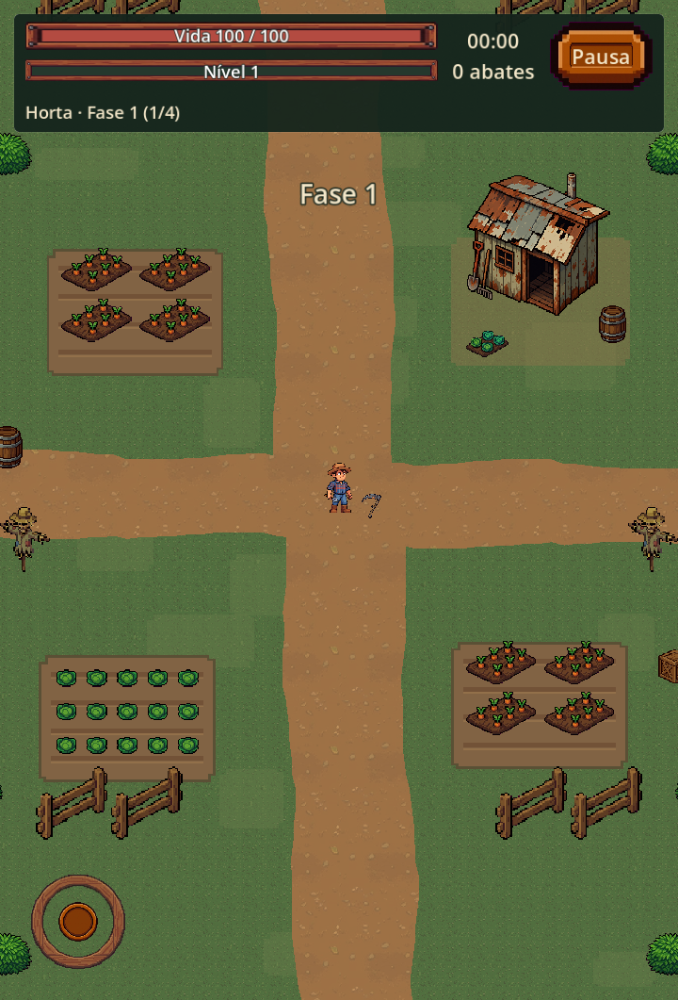
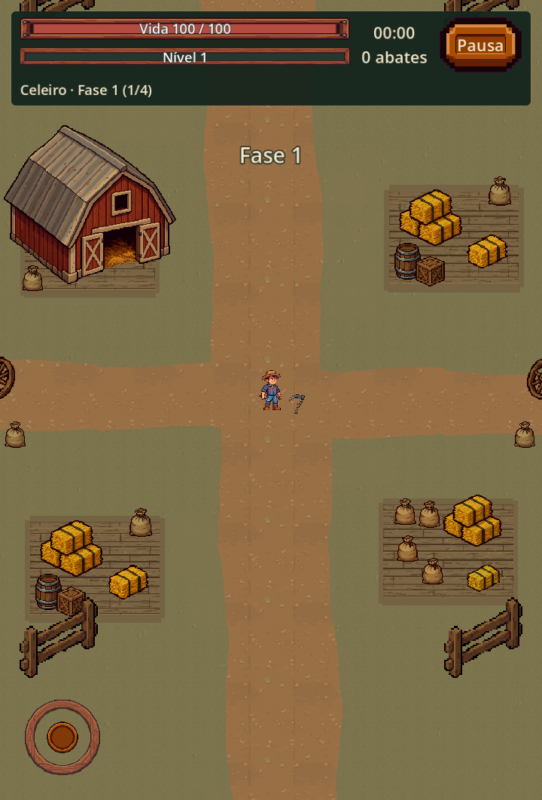
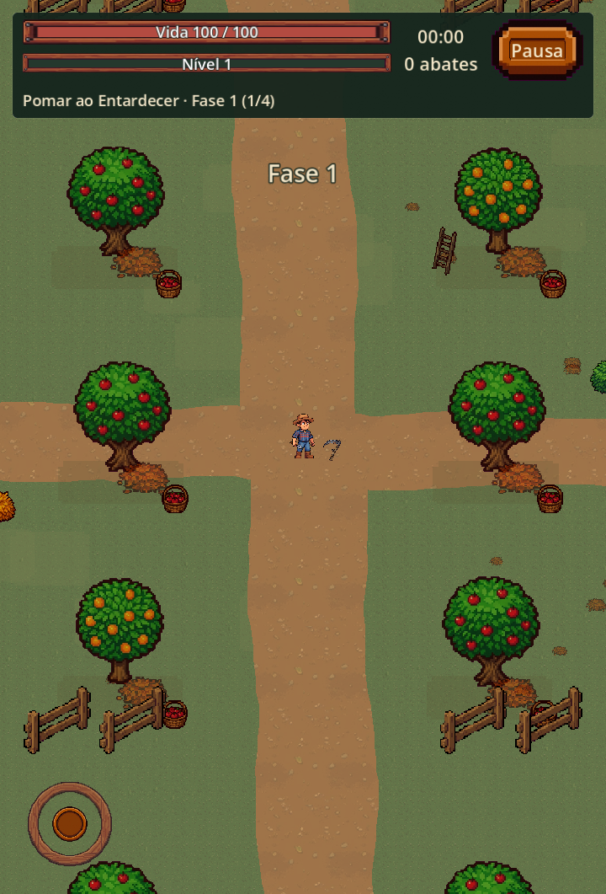

# Remodelagem da Horta, Celeiro e Pomar — 18/10/2026

Implementação visual dos três mapas, inspirada nas cinco imagens fornecidas pelo usuário e apoiada por pesquisa do gênero. O chão uniforme e a distribuição aleatória de poucos objetos deram lugar a caminhos, parcelas de cultivo, locais de trabalho e fileiras de árvores. As regras de combate permanecem com os valores existentes.

## Ver o resultado

As imagens abaixo são capturas reais do renderizador do jogo. A resolução obtida neste computador foi 720 × 1061; a janela solicitada era 720 × 1280. A composição se adapta ao viewport.

| Mapa | Antes | Depois | Visão ampla | Leitura com inimigos |
|---|---|---|---|---|
| Horta | [Abrir](capturas/map_before_horta.png) | [Abrir](capturas/map_after_horta.png) | [Abrir](capturas/map_overview_horta.png) | [Abrir](capturas/map_combat_horta.png) |
| Celeiro | [Abrir](capturas/map_before_celeiro.png) | [Abrir](capturas/map_after_celeiro.png) | [Abrir](capturas/map_overview_celeiro.png) | [Abrir](capturas/map_combat_celeiro.png) |
| Pomar | [Abrir](capturas/map_before_pomar.png) | [Abrir](capturas/map_after_pomar.png) | [Abrir](capturas/map_overview_pomar.png) | [Abrir](capturas/map_combat_pomar.png) |

### Horta



### Celeiro



### Pomar



As capturas de combate posicionam 24 inimigos para inspeção de contraste; movimento, ataques e spawner ficam desativados nesse cenário de QA. Elas não representam uma partida gravada. Capturas `map_distant_*` verificam também uma posição afastada do início, em `(3360, -2780)`.

## Pesquisa e decisões de design

Consulta a fontes oficiais em 18/10/2026. As decisões visuais na coluna final são interpretações de design aplicadas a este projeto, não declarações dos desenvolvedores dos outros jogos.

| Referência | O que a fonte oficial estabelece | Aplicação neste jogo |
|---|---|---|
| [Brotato — página oficial na Steam](https://store.steampowered.com/app/1942280/Brotato/) | Arena vista de cima, combate contra hordas e armas automáticas. A página contém imagens de gameplay. | Priorizar contraste entre arena e entidades; chão com detalhes discretos e objetos agrupados para permitir leitura do combate. |
| [Vampire Survivors — poncle](https://poncle.games/vampire-survivors) | Sobrevivência com gameplay minimalista e progressão entre partidas. | Elementos de cenário comunicam o lugar sem exigir novas interações, desviar o controle ou mudar o fluxo de uma run. |
| [Atomicrops — página oficial na Steam](https://store.steampowered.com/app/757320/Atomicrops/) | Mistura agricultura com ação bullet hell e defesa de uma fazenda. | Plantios e locais de trabalho contam a temática rural. Aqui os cultivos são apresentação, sem importar suas mecânicas de agricultura. |
| [Pesticide Not Required — página oficial na Steam](https://store.steampowered.com/app/2479320/Pesticide_Not_Required/) | Combina bullet heaven com agricultura e variações de mapas por estação. | Dar a cada ambiente uma paleta e grupos de elementos próprios, mantendo coerência entre terreno, plantações e construções. |

Dos anexos, foram aproveitadas a organização dos canteiros, caminhos de terra, materiais gastos, construções rurais e massas de vegetação. A vila com telhados e praça serve como referência de composição e profundidade; o mapa não foi transformado em cidade nem recebeu ruas estreitas ou paredes bloqueando passagem. As cinco referências foram preservadas em `referencias_usuario/`.

## Composição de cada mapa

| Mapa | Tratamento do chão | Grupos visuais | Papel na orientação |
|---|---|---|---|
| Horta | Grama verde oliva, caminhos de terra com bordas em degraus irregulares, solo marrom com sulcos. | Canteiros de cenouras e repolhos, espantalhos, arbustos, cercas abertas, galpão de ferramentas e barril. | Canteiros mostram uma fazenda cultivada; galpão marca uma área de trabalho; eixos de terra organizam visualmente o espaço. |
| Celeiro | Terreiro seco com caminhos, rastros sutis de carroça, palha esparsa e pequenos pisos de madeira nas áreas de carga. | Celeiro vermelho com portas abertas, fardos, sacos de grãos, barris, caixas e rodas. Grupos alternam entre feno, caixotes e grãos. | A construção identifica o mapa; armazenamento sugere uso do local sem formar paredes ou corredores obrigatórios. |
| Pomar | Vegetação oliva mais seca, caminhos de terra, pequenas manchas sob as árvores e folhas discretas. | Fileiras de macieiras e laranjeiras, cestos, escada de colheita, arbustos e trechos de cerca. | Repetição controlada das árvores comunica um pomar; frutas, cestos e folhas reforçam colheita e estação. |

As posições dos cultivos e áreas de carga têm pequenas variações determinísticas. Galpões e celeiros são marcos menos frequentes nas parcelas distantes, evitando uma construção idêntica em cada bloco. A parcela inicial garante a presença do marco característico. A vegetação é desenhada atrás de personagens, inimigos, projéteis e efeitos.

## Assets utilizados e preservação dos originais

Reutilizados os pisos e props já preparados em `art/polished/`, o piso de terra em `art/tile_pomar.png` e recortes das folhas enviadas anteriormente. Não foi necessário redesenhar personagens ou inimigos.

Quatro folhas originais foram copiadas intactas para `art/mapa_rural/`. [sources.json](../../art/mapa_rural/sources.json) registra origem, dimensões e SHA-256:

- `garden_sheet.jpg`: arbusto e canteiros.
- `barn_sheet.jpg`: pilha de feno e saco de grãos.
- `orchard_sheet.jpg`: macieira, laranjeira e arbusto seco.
- `cabbage_sheet.jpg`: repolho individual.

`map_art.gd` define regiões de atlas explícitas para excluir vizinhos e rótulos. As folhas com fundo magenta continuam intactas no disco; `map_chroma.gdshader` remove a chave na renderização. O filtro nearest mantém os pixels definidos. O shader também descarta alpha abaixo de 0,875 nas construções geradas e torna o interior opaco antes da modulação, evitando halos de semitransparência no cenário.

Faltavam construções isoladas prontas para o mapa. Foram criados **dois novos assets pela ferramenta de imagem integrada do Codex**, a partir das referências e do estilo das folhas existentes:

| Asset novo | Arquivo de produção | Função |
|---|---|---|
| Celeiro vermelho | [barn_building.png](../../art/mapa_rural/barn_building.png) | Marco do terreiro de armazenamento. |
| Galpão de ferramentas | [garden_shed.png](../../art/mapa_rural/garden_shed.png) | Marco da área de cultivo. |

Os resultados brutos também estão em `gerados/`; o [conjunto completo de prompts e referências](prompts_construcoes.json) documenta a geração no modo integrado, sem CLI ou chave de API. Regiões de atlas removem apenas as margens vazias para ancorar as construções. Os cinco anexos e todas as fontes externas originais permanecem sem alterações.

## Arquitetura e garantias de gameplay

- `main.gd` cria `FarmLandscape` com o mapa selecionado. O `GroundTileMap` antigo fica oculto, e a música, fases e configuração do spawner continuam no fluxo existente.
- `farm_landscape.gd` mantém um cache de parcelas de 1024 × 1024 unidades ao redor do jogador. A cobertura considera viewport e zoom. Parcelas antigas saem da árvore; o cache não aumenta com a distância percorrida.
- `farm_landscape_chunk.gd` monta listas estáticas de desenho para chão, caminhos e props. Não há centenas de nós de colisão ou de scripts por objeto. As listas são reconstruídas quando uma parcela entra no cache, não a cada frame.
- Cada parcela usa `RandomNumberGenerator` próprio, com seed derivada de mapa e coordenadas. O gerador global usado por gameplay não é consumido.
- A camada visual usa `z_index=-8`; não contém `CollisionObject2D`, `CollisionShape2D`, navegação ou timers. Cercas, árvores e construções são atravessáveis. Não existem interiores interativos, zonas de lentidão ou novos limites de arena.
- A região inicial de 150 unidades ao redor do spawn não recebe âncoras de objetos altos. Caminhos são orientação visual; o jogador pode combater e se mover também fora deles.
- Pausa congela a atualização do cenário. O cache retoma após liberar a pausa.
- `MapDB`, inimigos, chefes, alcance, dano, velocidade, recompensas, fases e regras de spawn não foram modificados.

## Testes e evidências

Os logs da entrega ficam em `evidencias/`.

| Suíte | Verificações | Falhas |
|---|---:|---:|
| Mapas: cobertura, cache, determinismo, RNG, pausa, movimento e ausência de física | 77 | 0 |
| Vovó Resistente | 37 | 0 |
| Fazendeiro | 45 | 0 |
| Controle e estabilidade | 78 | 0 |
| Interface | 121 | 0 |
| Arte, efeitos e estados de morte | 76 | 0 |
| **Total** | **434** | **0** |

A suíte de mapas verifica deslocamentos positivos e negativos, inclusive posições além de 20 mil unidades, retorno determinístico ao início, cobertura após mudar zoom, descarte das parcelas antigas, movimento real sobre canteiro/construção/árvore e preservação dos dados de campanha. Os testes usam saves próprios em `tests/.tmp/`.

Foram capturadas 15 imagens: três antes da alteração e 12 após a remodelagem, incluindo enquadramento normal, visão ampla, posição distante e cena controlada com inimigos para cada mapa. Revisados transparência, recortes e legibilidade.

Na versão inicial da remodelagem, os trechos de caminho alternavam textura e cor em muitos comandos. Caminhos passaram a ser polígonos texturizados e as parcelas compartilham material. A primeira medição tinha 534/646/510 chamadas de desenho nas cenas com inimigos; a medição final registrou **157 na Horta, 172 no Celeiro e 156 no Pomar**, incluindo HUD e entidades de QA, neste computador com RTX 4050/D3D12. Esses números não são uma medição de FPS nem uma garantia de desempenho em Android.

## Limites e próximos polimentos

- Falta validação em Android físico, principalmente de memória, fragment shader e tempo de criação de parcelas durante deslocamento.
- A composição usa parcelas repetíveis com variações; não é um mundo inteiro desenhado manualmente. Marcos exclusivos e variações maiores podem ser acrescentados posteriormente.
- Construções e árvores são atravessáveis e desenhadas atrás dos atores, conforme o requisito de preservar gameplay. Essa escolha prioriza o combate sobre a sensação de obstáculo físico.
- O celeiro e o galpão são novas artes geradas para preencher a falta de construções nos sprites disponíveis. As referências guiam a composição; não são cópias exatas dos mapas anexados.

## Repetir a validação

Na raiz do projeto, com Godot disponível no PATH:

```powershell
foreach ($suite in @('map_landscape_suite', 'vovo_animation_suite', 'farmer_animation_suite', 'stability_suite', 'ui_suite', 'art_suite')) {
    godot --headless --audio-driver Dummy --path . --script "res://tests/$suite.gd"
    if ($LASTEXITCODE -ne 0) { throw "Falha em $suite" }
}
```

Para capturas, execute `tests/map_visual_smoke.gd` com renderizador ativo. `-- --baseline` é apenas a opção de nomeação de imagens utilizada antes da alteração; executá-la agora captura o código atual, não restaura a versão anterior. A revisão antes/depois preservada acima corresponde ao registro feito durante esta implementação.
